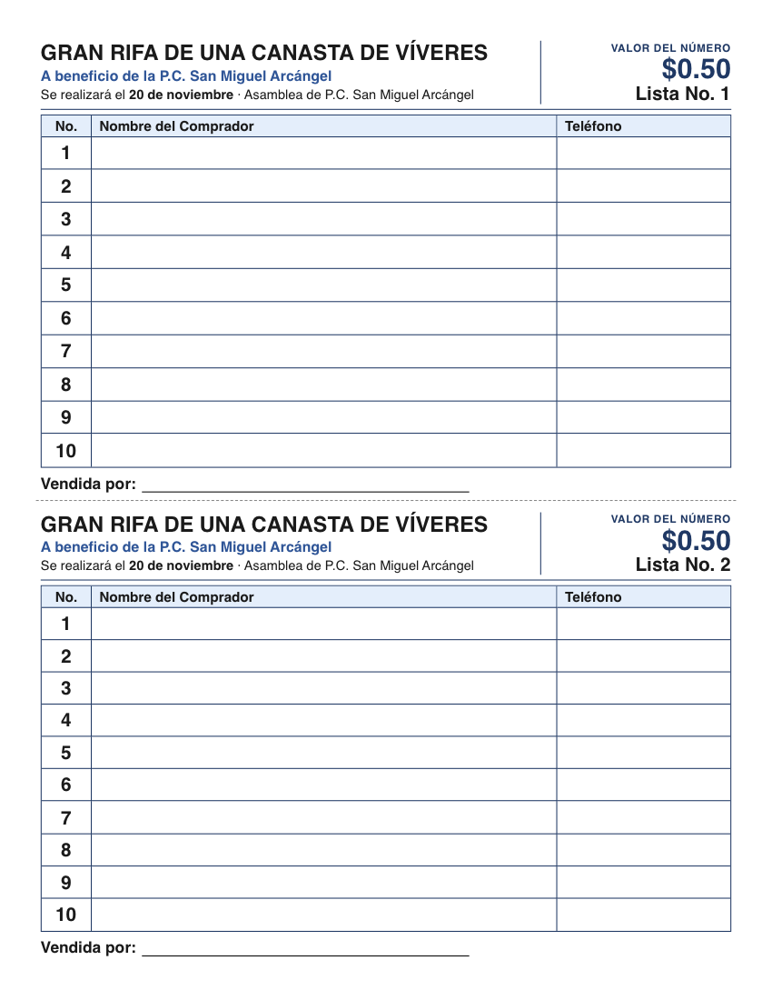

# Generador de listas de rifa

Herramienta web de un solo archivo para generar e imprimir listas de rifa en hojas tamaño carta, **dos listas por hoja** (media página cada una), con letra grande y filas altas para escribir a mano.

Creada para la rifa de una canasta de víveres a beneficio de la P.C. San Miguel Arcángel, pero sirve para cualquier rifa: todos los textos se pueden cambiar.



## Uso

No requiere instalación ni internet para funcionar.

1. Abre `index.html` en Chrome, Safari o Edge.
2. Elige el rango de listas (por ejemplo, de la 10 a la 50).
3. Ajusta los textos y la fecha.
4. Pulsa **Imprimir o guardar PDF**.

En el diálogo de impresión usa tamaño **Carta**, escala **100 %** y desactiva los encabezados y pies de página.

## Funciones

- **Rango de listas:** genera de la lista *N* a la *M*; cada hoja lleva dos.
- **Números por lista:** de 1 a 20 (10 por defecto). Menos números dan filas más altas.
- **Textos editables:** título, valor del número, beneficio, fecha del sorteo (o un texto propio) y evento o lugar.
- **Opciones:**
  - Lista ya numerada o con una raya para escribirla.
  - Línea "Vendida por".
  - Boletos seguidos (la lista 2 lleva del 11 al 20, y así).
- **Presets:** guarda y carga configuraciones con nombre. Se almacenan en el navegador (`localStorage`), por lo que no viajan entre equipos.
- **Vista previa a escala** de cada hoja, con resumen de listas, hojas y recaudo si se vende todo.
- **Modo oscuro** automático en la interfaz; la hoja impresa siempre es blanca.

## Estructura

```
index.html        # toda la aplicación (HTML, CSS y JS)
docs/             # imágenes del README
```

## Valores por defecto

| Campo | Valor |
|---|---|
| Título | GRAN RIFA DE UNA CANASTA DE VÍVERES |
| Valor del número | $0.50 |
| Beneficio | A beneficio de la P.C. San Miguel Arcángel |
| Fecha | 20 de noviembre |
| Evento | Asamblea de P.C. San Miguel Arcángel |

Se cambian en el panel o en los atributos `value` de `index.html`.

## Notas técnicas

- Sin dependencias ni paso de compilación. Las fuentes de la interfaz vienen de Google Fonts y tienen alternativas locales si no hay conexión.
- La hoja impresa usa Helvetica/Arial y unidades físicas (`in`, `pt`), con `@page { size: letter }`, para que el resultado sea igual en cualquier navegador.
